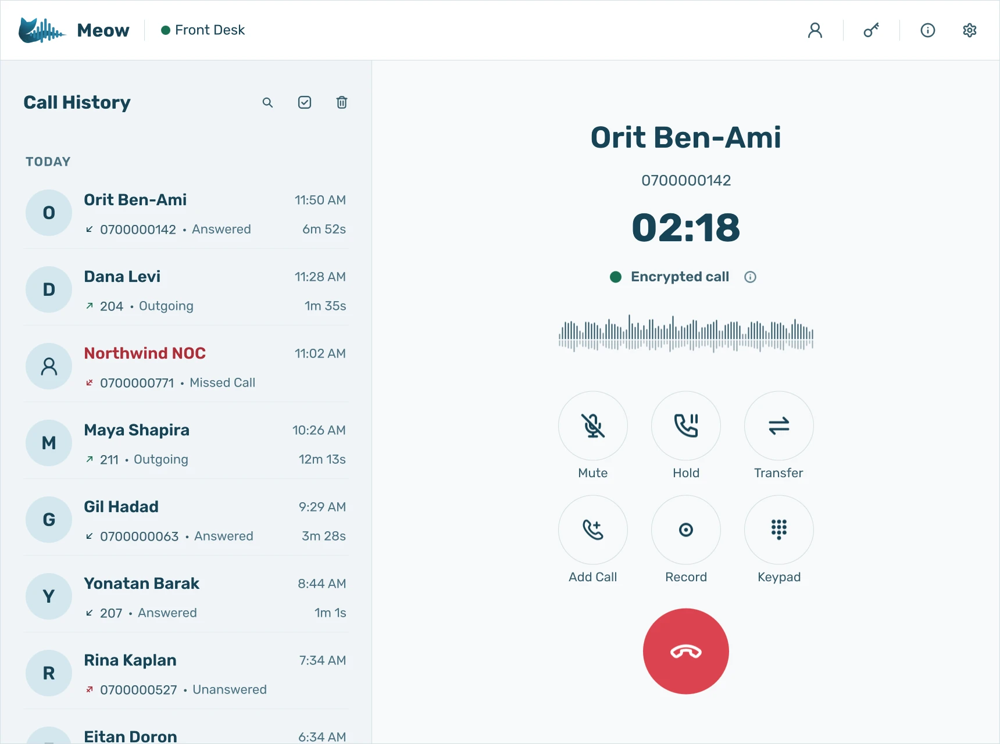
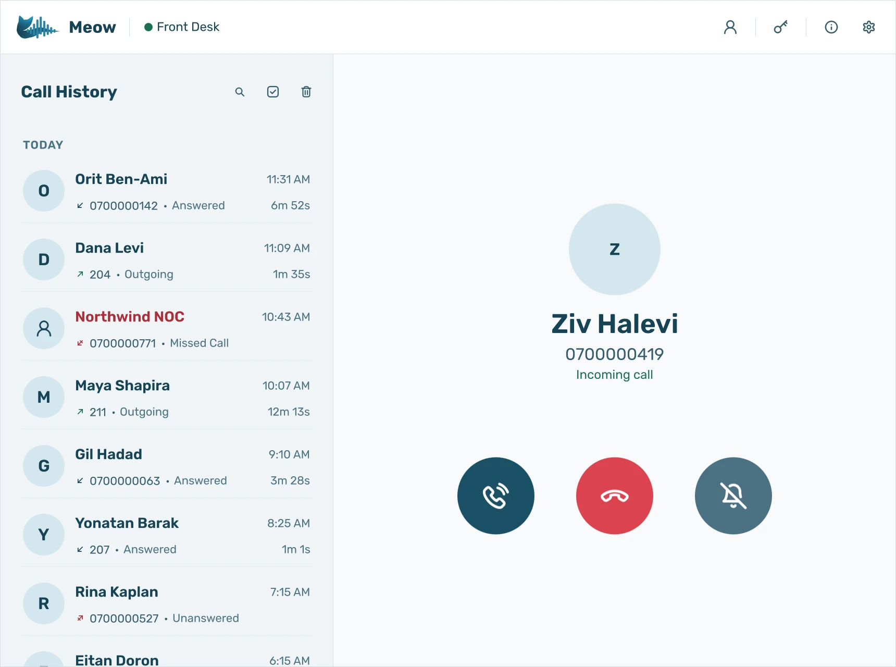
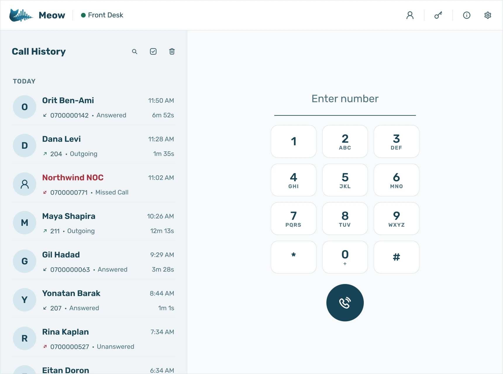
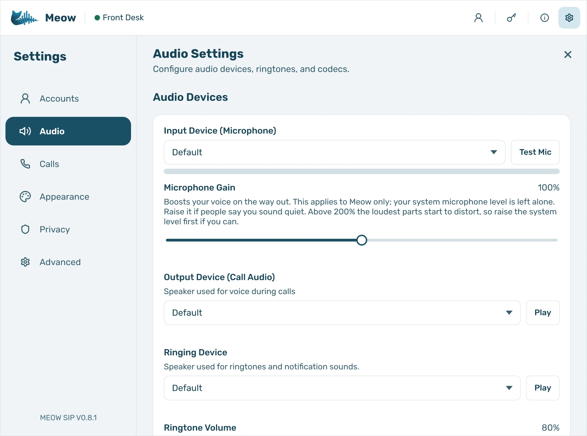

  

<h1 align="center">Meow</h1>

  A native SIP softphone for Linux and Windows, for offices on FreePBX, Asterisk or any SIP PBX. 
  <a href="https://meow.qfiber.co.il/download"><b>Download</b></a> ·
  <a href="https://meow.qfiber.co.il">Website</a> ·
  <a href="https://meow.qfiber.co.il/getting-started">Getting started</a> ·
  <a href="https://meow.qfiber.co.il/faq">FAQ</a> ·
  <a href="https://meow.qfiber.co.il/changelog">Changelog</a>

  

Meow is a desktop SIP client written in C++ and Qt 6 on the baresip SIP stack. It
registers to FreePBX, Asterisk, 3CX, FusionPBX, Kamailio, OpenSIPS or any standard
SIP provider and gives a computer the call handling of a desk phone.

This repository is where you report bugs, ask for features and follow releases.
Meow itself is proprietary software by qFiber LTD; its source code is not published
here.

## Features

- **Two SIP lines at once**, and several numbers behind one account
- **Busy lamps (BLF)** for colleagues, **call parking** and a **voicemail indicator** with FreePBX and Asterisk
- Hold and swap, **blind and attended transfer**, **three-way conference**, **call recording** saved on your computer
- **Opus, G.722 and G.711**, over UDP, TCP or **TLS**, with **SRTP** when your PBX offers it
- Contact cards with every number, vCard import and export, history grouped by person
- Microphone, call audio and ringing on separate devices, with echo cancellation
- Calls go straight between your computer and your PBX; there is no relay of ours in between

| Incoming call | Idle | Audio settings |
|---|---|---|
|  |  |  |

## Download

Get the current release from **[meow.qfiber.co.il/download](https://meow.qfiber.co.il/download)**,
with a SHA-256 checksum for each file:

| Platform | Package |
|---|---|
| Windows 10 and later (64-bit) | Installer (`meow-setup.exe`), with a silent-install switch |
| Ubuntu, Debian and derivatives | `.deb` |
| Fedora and other rpm-based distributions | `.rpm` |
| Any x86_64 Linux with glibc 2.34+ | AppImage |

On Linux, Meow needs **PipeWire 0.3.50 or newer**. Wayland is recommended and X11 is
supported. Releases are tested on Fedora 36+ and Ubuntu 23.04+; Debian 12, Linux Mint 22
and Arch run the AppImage.

Every feature is free for **14 days** with no card. After that Meow needs a licence; see
[pricing](https://meow.qfiber.co.il/pricing).

## Reporting a bug

[Open an issue](../../issues/new/choose) with your Meow version, operating system and
PBX, and the steps that cause it.

Please do not post SIP passwords, licence keys or phone numbers in an issue: issues are
public.

## Links

- [Meow for Linux](https://meow.qfiber.co.il/linux-softphone) ·
  [Meow for Windows](https://meow.qfiber.co.il/windows-softphone) ·
  [Meow with FreePBX and Asterisk](https://meow.qfiber.co.il/freepbx-softphone)
- [PBX setup](https://meow.qfiber.co.il/pbx-setup): what busy lamps, parking and the voicemail indicator need on the PBX
- [Security](https://meow.qfiber.co.il/security) · [Privacy](https://meow.qfiber.co.il/privacy) · [Terms](https://meow.qfiber.co.il/terms)
- [Contact](https://meow.qfiber.co.il/contact) · hello@qfiber.co.il

© qFiber LTD. All rights reserved.
